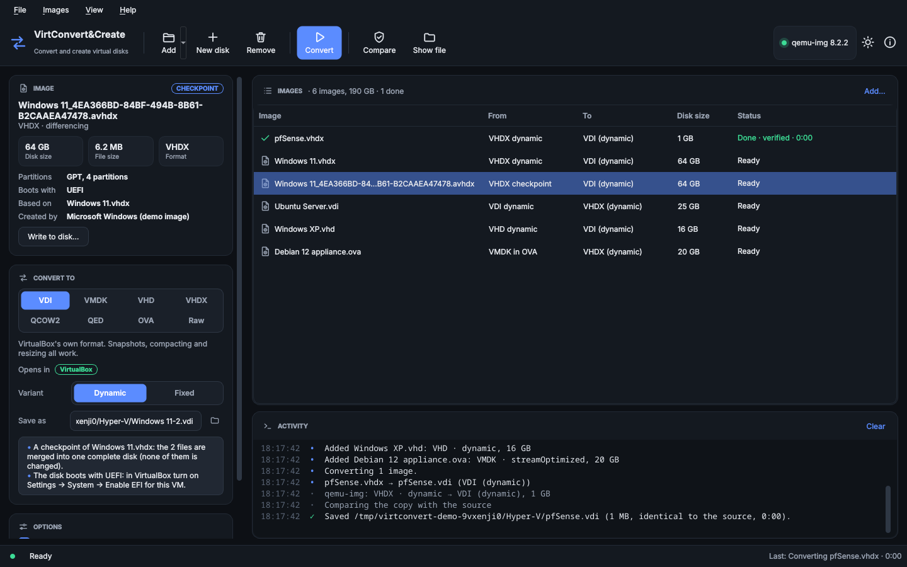
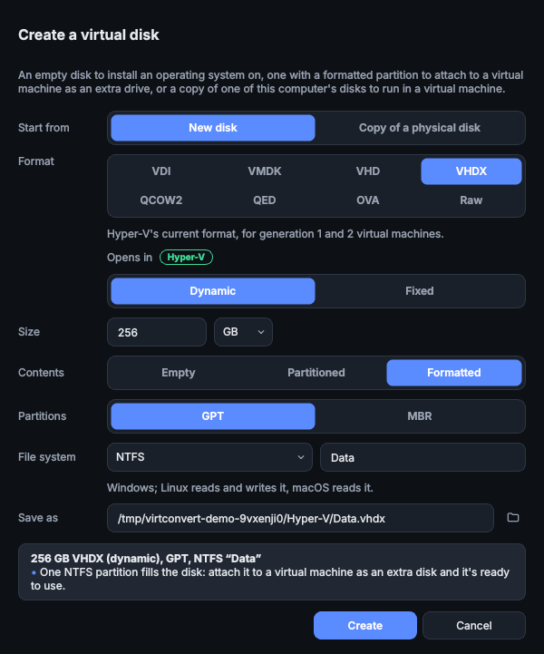
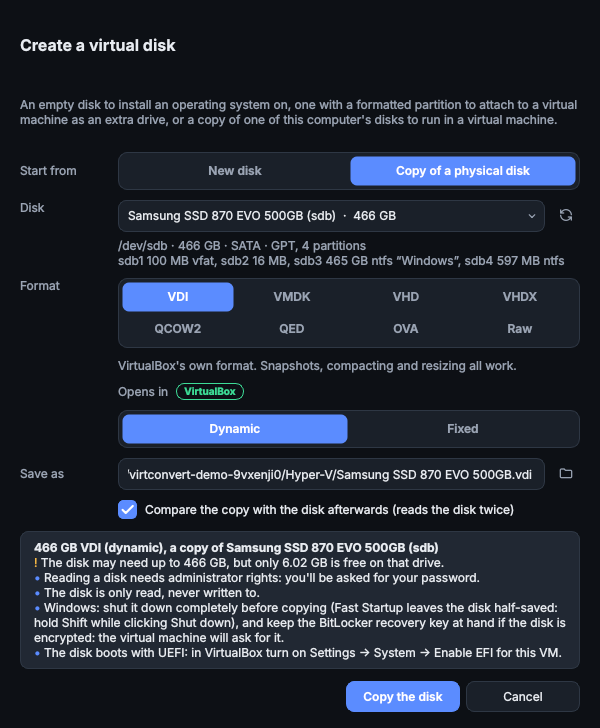
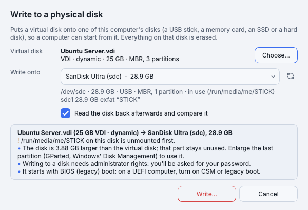
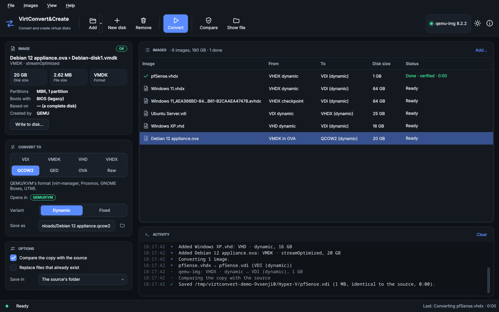
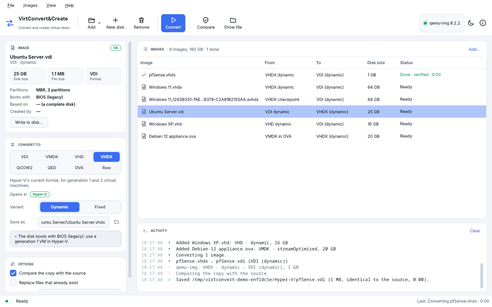
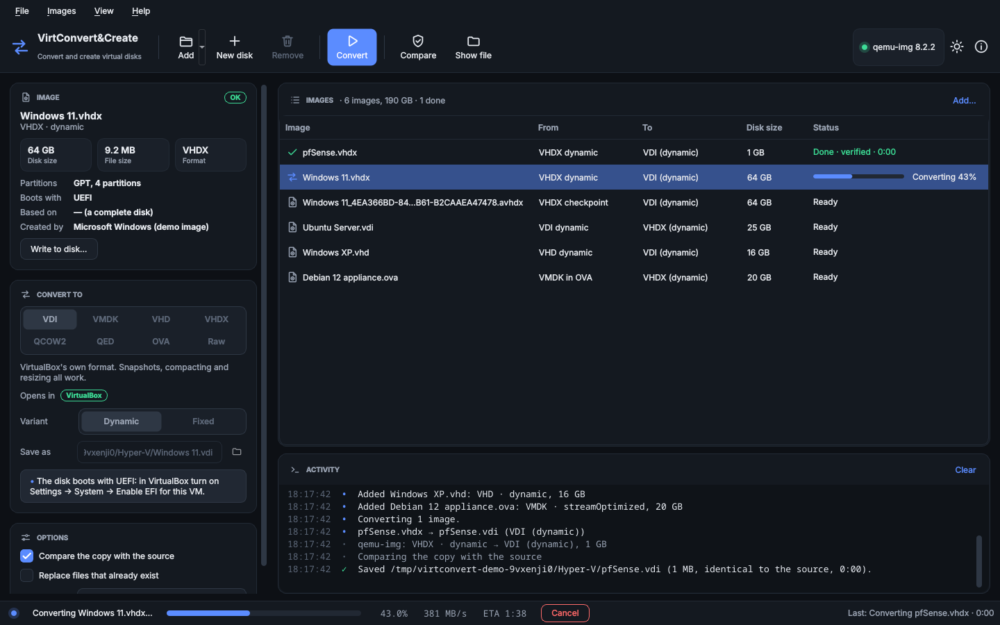

# VirtConvert&Create: convert and create virtual disks

VirtConvert&Create converts virtual disks between **VirtualBox, Hyper-V, VMware and QEMU/KVM** (VDI,
VMDK, VHD, VHDX, QCOW2, QED, OVA appliances and raw images) and **creates new disks**: empty, with
a partition already formatted as NTFS, exFAT, FAT32, ext4, Btrfs or XFS, or as a **copy of a
physical disk** (a hard disk, an SSD, a USB stick or a memory card) to run in a virtual machine. And
it **writes virtual disks onto physical ones**, so a real computer starts from them. It is made for Arch
Linux and installs just as easily on Debian, Ubuntu, Fedora, openSUSE and the other popular
distributions. There is a desktop app in the style of [EZP2019Linux](https://github.com/oreo1298/EZP2019Linux)
and a command line for scripts.

VirtConvert&Create is the new name of VirtConvert since version 1.1, which added creating disks and
the other formats; see [Updating from VirtConvert 1.0](#updating-from-virtconvert-10).



## Features

- **Convert in every direction**: Hyper-V disks (VHD, VHDX) become VDI for VirtualBox, VirtualBox
  and VMware disks (VDI, VMDK) become VHDX for Hyper-V, and any of them can become VMDK, VHD, QCOW2
  (QEMU/KVM, Proxmox, virt-manager), QED, an OVA appliance or a raw image. Parallels, DMG, ISO and
  old QCOW images can be read too.
- **Create new disks** in any of those formats, up to 64 TB: empty (to install an operating system
  on), with a GPT or MBR partition table, or with one partition formatted as NTFS, exFAT, FAT32,
  ext4, Btrfs or XFS, ready to attach to a virtual machine as an extra drive. Only the file
  system's own structures are written, so even a 2 TB disk is made in a second or two.
- **Physical disks into virtual ones**: copy one of the computer's disks, or a USB stick or memory
  card, into any of those formats, to run it in a virtual machine or keep it as an image. The
  disk is only read; you're asked for your password to read it, and nothing else runs as root.
- **Virtual disks onto physical ones**: write any image (every format above, ISO files, the disk in
  an OVA, checkpoints merged with their parents) onto a USB stick, a memory card, an SSD or a hard
  disk, so a computer starts from it. You confirm before the disk is erased, the disk is read back
  and compared afterwards, and the partition table is fitted to the disk: a larger disk keeps the
  rest free, a smaller one works when the partitions fit.
- **Appliances**: the disks inside an OVA are read in place (an OVA with several disks shows one
  entry per disk), and converting to **OVA** packs the disk with a small machine description for
  **File → Import Appliance** in VirtualBox and VMware.
- **Checkpoints and snapshots**: a Hyper-V checkpoint (`.avhdx`, `.avhd`) or a VirtualBox
  snapshot only holds what changed since its parent. VirtConvert&Create finds the parents (also when
  the files were moved or renamed) and merges the whole chain into one complete disk. The original
  files are never changed.
- **Every copy is checked**: after converting, the new disk is compared with the source byte for
  byte before it gets its real name. An interrupted or failed conversion leaves nothing behind.
- **Tells you how to boot it**: VirtConvert&Create reads the partition table and says whether the
  guest boots with UEFI or BIOS, so you know to turn on *Enable EFI* in VirtualBox, or which
  Hyper-V generation to pick.
- **Options for each target**: dynamic or fixed disks; VMDK as one file, preallocated (with a
  `-flat` data file), in 2 GB files (VMware Workstation) or stream-optimized (ESXi); Azure-ready
  VHD files (fixed, rounded up to whole megabytes).
- **Several images at once**: a list you can fill by drag and drop, converted one after the other
  with progress, speed and time left, and **Cancel**.
- **Command line**: `virtconvert info`, `convert`, `create`, `write`, `disks`, `verify`, `repair`,
  `formats` and `doctor`.
- Dark and light themes that follow the desktop setting.

VirtConvert&Create also fixes problems you would hit with `qemu-img` alone:

| Problem with plain `qemu-img` | What VirtConvert&Create does |
|---|---|
| A differencing VHD is converted **without its parent, without any error**: the result is missing most of the disk. A differencing VHDX is refused. | Reads the chain itself and hands qemu-img the merged disk. |
| A fixed VHD is taken for a raw image, and VirtualBox-made VHDs are cut short by a few KB (qemu-img sizes them by their CHS geometry). | Detects the format itself and always uses the full disk size, like Hyper-V and VirtualBox do. |
| VHDX files written by qemu-img can't even be read by VirtualBox (the "required" flag on their block table is missing). | Sets the flag the VHDX specification asks for, so VirtualBox can read them too. |
| A disk inside an OVA has to be unpacked first, and an OVA can't be written at all. | Reads the disk inside the archive, and writes OVA files VirtualBox imports. |

| A new disk with an NTFS partition | A copy of a physical disk |
|---|---|
|  |  |

| Writing onto a USB stick (light theme) | An appliance going to QEMU/KVM |
|---|---|
|  |  |

| Going back to Hyper-V (light theme) | Converting |
|---|---|
|  |  |

## Installation

VirtConvert&Create needs **Python 3.10+**, **qemu-img** (from the QEMU project; it writes the
disks) and, for the app, **PySide6** (Qt 6). To create formatted disks it uses your distribution's
**mkfs programs** (see [New disks](#new-disks)). The installers below take care of all of it.
VirtualBox itself is not needed.

### Arch Linux, CachyOS, EndeavourOS, Manjaro, Garuda and other Arch-based distributions

The repository includes a PKGBUILD, so VirtConvert&Create installs as a normal pacman package. Run
these as your normal user (not root); `makepkg` asks for your password when it installs the package:

```sh
sudo pacman -S --needed git base-devel
git clone https://github.com/oreo1298/VirtConvert.git
cd VirtConvert
makepkg -si
```

This installs the `virtconvert` command, **VirtConvert&Create** in your application menu, and the
dependencies `python`, `pyside6`, `qt6-svg`, `qt6-wayland` and `qemu-img`. For formatted new disks,
add the file systems you want (ext4 needs nothing extra):

```sh
sudo pacman -S --needed dosfstools exfatprogs ntfsprogs btrfs-progs xfsprogs
```

- **Update:** pull the new code and rebuild from the same folder:

  ```sh
  cd VirtConvert
  git pull
  makepkg -sif
  ```

  (`-f` rebuilds even if a package of the same version is already there.)
- **Uninstall:** `sudo pacman -Rns virtconvert` (your settings in `~/.config/virtconvert` stay;
  delete the folder if you like. qemu-img is removed too if nothing else needs it.)

If `makepkg` says `PKGBUILD does not exist`, you are not inside the `VirtConvert` folder.

### Every other distribution: the installer

`packaging/install.sh` recognises your package manager (**apt, dnf, zypper, xbps, apk, eopkg,
emerge**), installs qemu-img, Python and the mkfs programs after asking, installs
VirtConvert&Create into `/opt/virtconvert`, and adds the `virtconvert` command and the menu entry:

```sh
git clone https://github.com/oreo1298/VirtConvert.git
cd VirtConvert
./packaging/install.sh          # asks for your password (sudo)
```

First install git for your distribution:

| Distribution | Install git first |
|---|---|
| **Ubuntu 22.04 and newer, Linux Mint, Pop!_OS, Zorin OS, elementary OS, KDE neon, Debian 12/13** | `sudo apt install git` |
| **Fedora, Nobara, Ultramarine** | `sudo dnf install git` |
| **RHEL, AlmaLinux, Rocky Linux 9+** | `sudo dnf install epel-release git` (EPEL has a library the app needs on X11) |
| **openSUSE Tumbleweed / Leap** | `sudo zypper install git` |
| **Void Linux** | `sudo xbps-install -S git bash` |
| **Alpine Linux** | `sudo apk add git bash` (enable the community repository for PySide6) |
| **Solus** | `sudo eopkg install git` |
| **Gentoo** | `sudo emerge --noreplace dev-vcs/git` |

- **Update:** `cd VirtConvert && ./packaging/update.sh` (pulls the latest version and reinstalls
  it the same way; your settings stay). `make update` does the same.
- **Uninstall:** `./packaging/uninstall.sh` (add `--purge` to also delete your settings; your
  disk images are never touched, and qemu-img stays installed). `make uninstall` does the same.

Notes:

- The installer asks before installing packages when qemu-img is missing; run it with `--deps` to
  install the dependencies (and the mkfs programs) on a system that already has qemu-img.
- Where your distribution packages PySide6 (Fedora, openSUSE Tumbleweed, Debian 13, Alpine), it is
  used; elsewhere (Ubuntu 22.04/24.04, Mint 21/22, Debian 12, RHEL/Rocky) the installer downloads
  PySide6-Essentials (about 100 MB) into VirtConvert&Create's own folder. Nothing else on your
  system changes.
- RHEL/Rocky 9 and openSUSE Leap ship an older Python next to newer ones; the installer picks or
  installs Python 3.10+ by itself.
- If a package doesn't exist on your release, the installer says so and installs the rest;
  `virtconvert doctor` shows what's still missing and the command to install it.
- **Immutable systems** (Fedora Silverblue/Kinoite, Bazzite, SteamOS, openSUSE Aeon): run
  `sudo rpm-ostree install qemu-img` (then restart), and use the per-user install below.
- **NixOS**: add `qemu-utils` and `python3Packages.pyside6` to your configuration, then run
  `./virtconvert.sh` or the per-user install.

### Per-user install (no sudo for VirtConvert&Create itself)

```sh
./packaging/install.sh --user        # into ~/.local; qemu-img still comes from your package manager
./packaging/update.sh                # update
./packaging/uninstall.sh --user      # remove
```

Make sure `~/.local/bin` is on your `PATH` (the installer tells you if it isn't).

### Updating from VirtConvert 1.0

Version 1.1 renamed VirtConvert to **VirtConvert&Create**. The command (`virtconvert`), the
package, the install folders and your settings stay the same, so update the usual way: `git pull`
and `makepkg -si` on Arch, `./packaging/update.sh` everywhere else. Run `./packaging/install.sh
--deps` once if you want the installer to add the mkfs programs for formatted new disks.

If you installed the 1.1 build that was briefly published as *VertConvert&Create* (command
`vertconvert`), updating replaces it: pacman asks whether to remove the conflicting `vertconvert`
package (answer **y**), and the installer removes `/opt/vertconvert` (or `~/.local/lib/vertconvert`),
its command and its menu entry. Its settings are taken over.

### Try it without installing

```sh
./virtconvert.sh                     # the app (needs Python, PySide6 and qemu-img)
./virtconvert.sh convert disk.vhdx   # the command line
```

### Check the installation

```sh
virtconvert doctor
```

```
VirtConvert&Create 1.2.0 on Ubuntu 24.04.5 LTS
  ✓ Python             3.12.3
  ✓ qemu-img           8.2.2 (/usr/bin/qemu-img)
  ✓ PySide6 (the app)  6.11.2
  · VirtualBox         not installed
    Not needed for converting; install it to run the converted disks.
  ✓ NTFS (new disks)   /usr/sbin/mkntfs
  ✓ exFAT (new disks)  /usr/sbin/mkfs.exfat
  ✓ FAT32 (new disks)  /usr/sbin/mkfs.fat
  ✓ ext4 (new disks)   /usr/sbin/mkfs.ext4
  · Btrfs (new disks)  not installed
    Only needed to create Btrfs disks: sudo apt install btrfs-progs
  ✓ XFS (new disks)    /usr/sbin/mkfs.xfs
```

If qemu-img is missing, `virtconvert doctor` prints the command for your distribution, and
`virtconvert doctor --install-qemu` (or **Help → Install qemu-img…** in the app) installs it.

## Using the app

1. Start **VirtConvert&Create** from your application menu (or run `virtconvert`).
2. **Add** your images, or drop them on the window. Hyper-V disks (and QCOW2, raw and the others)
   are set to become VDI files for VirtualBox, VirtualBox and VMware disks to become VHDX files for
   Hyper-V; the app remembers what you pick for each. For a checkpoint (`.avhdx`), add the newest
   one: it is merged with its parents. An OVA with several disks becomes one entry per disk.
3. Select an image to see what it holds (size, partitions, how it boots, its parents) and to
   change the target under **Convert to** (eight formats; the variant below them), and the file
   name under **Save as**. The box under it lists anything worth knowing before converting.
4. Click **Convert** (<kbd>F5</kbd>). The converted file is saved next to the original unless you
   pick a folder under **Options**. Double-click a finished image to open its folder.

To make a new disk, click **New disk** (<kbd>Ctrl</kbd>+<kbd>N</kbd>): pick the format and size,
then **Empty**, **Partitioned** or **Formatted** (with the file system and a name), and where to
save it. The box at the bottom says what you will get, or what's missing. To copy a physical disk
instead, pick **Copy of a physical disk** at the top (see [below](#copying-a-physical-disk)).

To put a virtual disk onto a USB stick, a memory card or another disk, select it and click **Write
to disk…** (see [below](#writing-a-virtual-disk-onto-a-physical-disk)).

| Action | Shortcut |
|---|---|
| Add images | <kbd>Ctrl</kbd>+<kbd>O</kbd> |
| New disk | <kbd>Ctrl</kbd>+<kbd>N</kbd> |
| Add a physical disk to the list | <kbd>Ctrl</kbd>+<kbd>Shift</kbd>+<kbd>D</kbd> |
| Write to a physical disk | <kbd>Ctrl</kbd>+<kbd>Shift</kbd>+<kbd>W</kbd> |
| Convert | <kbd>F5</kbd> |
| Cancel | <kbd>Esc</kbd> |
| Remove from the list | <kbd>Del</kbd> |
| Compare two images | <kbd>Ctrl</kbd>+<kbd>K</kbd> |
| Open the folder of the converted file | <kbd>Ctrl</kbd>+<kbd>Shift</kbd>+<kbd>O</kbd> |
| Toggle dark/light theme | <kbd>Ctrl</kbd>+<kbd>Shift</kbd>+<kbd>T</kbd> |

### Using a converted disk in VirtualBox

1. Shut the virtual machine down in Hyper-V first (not *Save*): a running or saved VM gives an
   inconsistent copy (VirtConvert&Create stops if a file changes while it is being converted).
2. In VirtualBox: **New**, choose the guest type, and under **Hard Disk** pick **Use an Existing
   Virtual Hard Disk File** and select the `.vdi` (or `.vmdk`).
3. If VirtConvert&Create said the disk **boots with UEFI** (Hyper-V generation 2 VMs, most Windows
   10/11 installs), turn on **Settings → System → Enable EFI**.
4. Windows guests: if Windows stops with `INACCESSIBLE_BOOT_DEVICE`, attach the disk to a SATA
   (AHCI) controller (the default). Install the VirtualBox Guest Additions afterwards; you can
   uninstall the Hyper-V integration services.

An **OVA** is imported instead: **File → Import Appliance**, pick the `.ova`, and adjust the CPUs,
memory and network while importing (VirtConvert&Create sets 2 CPUs, 2 GB of memory, 4 GB for
Windows, a SATA disk and a NAT network card).

### Using a converted disk in Hyper-V

1. In Hyper-V Manager: **New → Virtual Machine**. Pick **Generation 2** if VirtConvert&Create said
   the disk boots with **UEFI**, **Generation 1** for **BIOS**. (Generation 2 needs VHDX.)
2. Under **Connect Virtual Hard Disk**, choose **Use an existing virtual hard disk** and select the
   `.vhdx` or `.vhd` file.
3. Linux guests on generation 2: turn Secure Boot off or use the *Microsoft UEFI Certificate
   Authority* template.

For **Azure**, convert with **VHD** and *For Azure* ticked (`virtconvert convert -t azure`): Azure
needs a fixed VHD whose size is a whole number of megabytes. Upload it as a page blob.

### Using a disk in QEMU/KVM, Proxmox or VMware

- **virt-manager, GNOME Boxes, Proxmox**: convert to **QCOW2**. A UEFI disk needs UEFI (OVMF)
  firmware in the VM settings. On Proxmox, copy the file to the host and run
  `qm disk import <vmid> disk.qcow2 <storage>`.
- **VMware Workstation and Player**: **VMDK** (dynamic or in 2 GB files); **ESXi**: VMDK
  *Stream* (`-t esxi`), or an **OVA** to deploy.

## New disks

**New disk** in the app, or `virtconvert create` on the command line, makes a disk in any of the
eight formats:

- **Empty**: nothing on it, to install an operating system on (attach it together with an
  installer ISO).
- **Partitioned**: a GPT (or MBR) partition table with one partition filling the disk, left
  unformatted, to format inside the VM.
- **Formatted**: the same partition with a file system, ready to use as an extra drive: attach it
  to a VM and its files are there.

| File system | For | Made with (package) |
|---|---|---|
| **NTFS** | Windows; Linux reads and writes it, macOS reads it | `mkntfs` (`ntfsprogs` on Arch, Fedora and openSUSE; `ntfs-3g` elsewhere) |
| **exFAT** | Sharing files between Windows, macOS and Linux | `mkfs.exfat` (`exfatprogs`) |
| **FAT32** | Every system and firmware; files up to 4 GB | `mkfs.fat` (`dosfstools`) |
| **ext4** | Linux's standard file system | `mkfs.ext4` (`e2fsprogs`, installed nearly everywhere) |
| **Btrfs** | Linux, with snapshots and compression | `mkfs.btrfs` (`btrfs-progs`) |
| **XFS** | Linux, for large files and servers | `mkfs.xfs` (`xfsprogs`) |

GPT is the default partition table: every current system reads it and it has no size limit. MBR
is there for old systems and BIOS-only tools (up to 2 TB). Partitions start at 1 MB, like the ones
Windows and Linux installers make. VHDX disks with Linux file systems use 1 MB blocks (as
Microsoft recommends for Linux guests), so the file stays small.

`virtconvert doctor` shows which file systems you can make and how to install the rest; the app
names the missing package when you pick one.

## Copying a physical disk

VirtConvert&Create can turn one of the computer's disks into a virtual disk: to keep running an old
PC's system in a virtual machine, to try a disk's system in VirtualBox before moving it, or to keep
an image of a USB stick or memory card.

- In the app: **New disk → Copy of a physical disk**, pick the disk, the format and where to save
  it, and click **Copy the disk**. Or **Add → Add physical disk…** puts it in the list, to convert
  it together with other images.
- On the command line: `virtconvert disks` lists the disks, then
  `virtconvert create old-pc.vdi --from /dev/sdb` (or `virtconvert convert /dev/sdb -t vhdx`).

Reading a disk needs administrator rights, so you are asked for your password (a password dialog
in the app, `sudo` in a terminal). Only a few lines run as root: they open the disk read-only and
hand it over; the copying itself runs as you, can be cancelled, and the image belongs to you.
Nothing is ever written to the disk.

Things to know:

- **Copy a disk that isn't in use.** The disk of the running system keeps changing while it is
  read, so its copy may be inconsistent (and can't be checked afterwards). To copy the system disk,
  start the computer from a live USB system (Ubuntu, Fedora, …), install VirtConvert&Create there or
  run it from a USB stick, and save the copy on another drive. Other disks: unmount them first.
- **Windows**: shut Windows down completely first (Fast Startup leaves the disk half-saved: hold
  <kbd>Shift</kbd> while clicking *Shut down*). A BitLocker-encrypted disk stays encrypted in the
  copy: have the recovery key at hand. In the virtual machine, Windows may need to be activated
  again.
- **Space**: a dynamic image leaves out the parts of the disk that are zeros (never written, or
  trimmed); deleted files that weren't trimmed are copied like the rest. The image never goes on
  the disk being copied: VirtConvert&Create refuses that.
- **Booting the copy**: like a converted disk (see above): turn on *Enable EFI* in VirtualBox for a
  disk that boots with UEFI; a Windows copy may stop at `INACCESSIBLE_BOOT_DEVICE` until the disk is
  attached to a SATA controller.
- **A failing disk**: if it has unreadable sectors, the copy stops at the first one and says where.
  Rescue it with `ddrescue` into an image file first, then convert that image.

## Writing a virtual disk onto a physical disk

The other way round: VirtConvert&Create puts a virtual disk onto one of the computer's disks, so a
real computer starts from it: to move a system out of a virtual machine onto real hardware, to
prepare a USB stick or a memory card (a bootable ISO, a Raspberry Pi image), or to restore a disk
from an image. Everything it reads can be written: VDI, VMDK, VHD, VHDX, QCOW2, QED, raw and ISO
images, the disk inside an OVA, checkpoints and snapshots (merged with their parents), and even
another physical disk (a disk-to-disk copy).

- In the app: select the image and click **Write to disk…** (in the Image box, the Images menu or
  the list's right-click menu; <kbd>Ctrl</kbd>+<kbd>Shift</kbd>+<kbd>W</kbd>). Pick the disk, read
  what the box under it says, click **Write…** and confirm erasing the disk.
- On the command line: `virtconvert disks` lists the disks, then `virtconvert write vm.vhdx /dev/sdb`.
  It asks you to type the disk's name to confirm (`--yes` skips that, for scripts).

**Everything on the chosen disk is erased.** VirtConvert&Create won't write onto the disk the running
system is on, a disk used by LVM, RAID or an unlocked encrypted volume, a write-protected card, or
the disk the image itself is stored on. File systems mounted from the disk are unmounted first, the
way the file manager does it. You're asked for your password to open the disk; as when copying a
disk, only a few lines run as root, and the writing runs as you.

Things to know:

- **Everything is written**, the empty parts as zeros too, so nothing of the old contents shows
  through. Then the disk is read back and compared with the image (untick *Read the disk back*, or
  `--no-verify`, to skip that).
- **A larger disk**: the rest stays unused. The partition table is fitted to the disk (a GPT's backup
  copy moves to the end of the disk, where it belongs), so GParted or Windows' Disk Management can
  enlarge the last partition into the free space.
- **A smaller disk** works when the partitions fit: the part of the image up to the disk's end is
  written (the end of a virtual disk is often unused space). If they don't fit, shrink the last
  partition inside the virtual machine first (GParted, or *Shrink volume* in Windows' Disk
  Management), then write again.
- **Starting it**: the box says whether the system starts with UEFI or BIOS (legacy boot); set the
  computer's firmware to match. Windows moved from a virtual machine to a real computer may need
  drivers for its disk controller (it stops at `INACCESSIBLE_BOOT_DEVICE` without them) and may ask
  to be activated again. Linux usually just starts.
- **Cancelling** stops right away, but leaves the disk partly written: write it again, or format it.
- **Disks with 4 KB sectors** (some NVMe SSDs and USB disks) can't use a partition table made for
  512-byte sectors, which is what virtual disks have; VirtConvert&Create says so instead of writing a
  disk that wouldn't start.

## Command line

Running `virtconvert` without a command opens the app (`virtconvert disk.vhdx` opens it with the
file in the list). Everything is also available as a command:

```sh
virtconvert info disk.vhdx                  # format, size, partitions, boot mode, parents
virtconvert info --json *.vhdx              # the same, for scripts
virtconvert info appliance.ova              # each disk inside the appliance

virtconvert convert disk.vhdx               # -> disk.vdi (VirtualBox)
virtconvert convert disk.vdi                # -> disk.vhdx (VirtualBox and VMware disks go to Hyper-V)
virtconvert convert "Win_8E2C….avhdx"       # a checkpoint: merged into one disk -> Win.vdi
virtconvert convert -t vmdk -d ~/VMs *.vhdx # several at once, into a folder
virtconvert convert -t vhdx --fixed disk.vdi
virtconvert convert -t vmdk --split disk.vdi   # VMware Workstation: disk.vmdk + disk-s001.vmdk…
virtconvert convert -t qcow2 disk.vhdx      # QEMU/KVM, Proxmox
virtconvert convert -t ova disk.vhdx        # an appliance for File → Import Appliance
virtconvert convert appliance.ova           # every disk of an appliance
virtconvert convert -t azure -o os.vhd disk.vdi

virtconvert create new.vdi -s 64G                        # an empty 64 GB disk
virtconvert create data.vhdx -s 1T --fs ntfs -L Data     # GPT + NTFS, ready to use
virtconvert create usb.vmdk -s 16G --fs fat32 --table mbr
virtconvert create linux -t qcow2 -s 200G --fs ext4      # -> linux.qcow2

virtconvert disks                                        # the physical disks
virtconvert create old-pc.vdi --from /dev/sdb            # a copy of one (asks for your password)
virtconvert convert /dev/sdc -t vhdx                     # the same through convert
virtconvert write vm.vhdx /dev/sdb                       # a virtual disk onto a physical one (erases it)
virtconvert write ubuntu.iso /dev/sdc --yes              # an ISO onto a USB stick, without asking

virtconvert verify disk.vhdx disk.vdi       # do two images contain the same disk?
virtconvert repair disk.vhdx                # apply the log of a VHDX that wasn't closed cleanly
virtconvert formats                         # formats, shortcuts and file systems
virtconvert doctor                          # is everything installed?
```

Options for `convert`: `-t/--to` (`vdi`, `vmdk`, `vhd`, `vhdx`, `qcow2`, `qed`, `ova`, `raw`, or the
shortcuts `virtualbox`, `hyperv`, `vmware`, `esxi`, `azure`, `proxmox`), `-o FILE`, `-d FOLDER`,
`--fixed`, `--split` (VMDK in 2 GB files), `--overwrite`, `--no-verify`, `--parent FILE` (where a
checkpoint's parent is, if it isn't found) and `-y` (don't ask about warnings).

Options for `create`: `-s/--size` (`64G`, `512M`, `2T`; a plain number is megabytes), `-t/--to`
(else the file name's extension decides), `--fixed`, `--split`, `--table gpt|mbr|none`,
`--fs ntfs|exfat|fat32|ext4|btrfs|xfs` (implies `--table gpt`), `-L/--label`, `--from DISK` (a copy
of a physical disk instead), `--overwrite`, `--no-verify`.

Options for `write`: `--no-verify` (don't read the disk back), `--member NAME` (the disk of an OVA
with several), `--parent FILE`, `-y/--yes` (don't ask before erasing the disk), `-q/--quiet`.

Exit status: 0 done, 1 failed, 130 cancelled.

## Formats

| Format | Read | Write | Opens in |
|---|---|---|---|
| **VDI** (`.vdi`) — dynamic, fixed, snapshots | ✓ | ✓ dynamic, fixed | VirtualBox |
| **VMDK** (`.vmdk`) — sparse, flat, split, stream-optimized, snapshots | ✓ | ✓ dynamic, preallocated (`-flat`), 2 GB files, stream-optimized | VirtualBox, VMware |
| **VHD** (`.vhd`, `.avhd`) — fixed, dynamic, differencing | ✓ | ✓ dynamic, fixed, Azure | Hyper-V gen. 1, Virtual PC, Azure, VirtualBox |
| **VHDX** (`.vhdx`, `.avhdx`) — fixed, dynamic, differencing, 512 B and 4 KB sectors | ✓ | ✓ dynamic, fixed | Hyper-V gen. 1 and 2 (VirtualBox only reads VHDX: convert to VDI to run it) |
| **QCOW2** (`.qcow2`) | ✓ | ✓ dynamic, preallocated | QEMU/KVM, Proxmox, virt-manager, GNOME Boxes |
| **QED** (`.qed`) | ✓ | ✓ | QEMU, VirtualBox |
| **OVA** (`.ova`) — appliances with one or more disks | ✓ | ✓ (stream-optimized VMDK inside) | VirtualBox and VMware (Import Appliance) |
| **Raw** (`.img`, `.raw`, `.bin`, `.dd`) | ✓ | ✓ sparse, preallocated | dd, QEMU, everything |
| **OVF** (`.ovf`) — the disk files it lists | ✓ | | VirtualBox, VMware |
| **Parallels** (`.hds`, or the `.hdd` folder) | ✓ | | Parallels Desktop |
| **DMG** (`.dmg`, UDIF) | ✓ | | macOS |
| **ISO** (`.iso`) | ✓ | | read as a disk |
| **QCOW** (`.qcow`, version 1) | ✓ | | QEMU |

Limits: VHD files hold up to 2040 GB, VHDX files up to 64 TB. A compressed disk inside an OVA
(`ovf:compression="gzip"`) has to be unpacked first; DMG files compressed with bzip2 or LZFSE need
qemu-img's DMG modules (a separate package on some distributions).

## Troubleshooting

- **"qemu-img missing"**: run `virtconvert doctor` for the install command, or click the
  qemu-img box in the toolbar.
- **"Making NTFS needs mkntfs, which isn't installed"**: install the package the message names
  (also shown by `virtconvert doctor`), then try again.
- **Copying or writing a disk: "needs administrator rights, and they weren't given"**: the
  password dialog was cancelled, or your account isn't an administrator. The app uses `pkexec`
  (package `polkit`, installed on every desktop); without it, use the command line in a terminal
  (`virtconvert create … --from /dev/sdX`, `virtconvert write … /dev/sdX`), which asks with `sudo`.
- **Copying a disk: "can't be read at … (input/output error)"**: the disk has a damaged sector.
  Rescue it with `ddrescue /dev/sdX rescued.img rescued.map`, then convert `rescued.img`.
- **Writing to a disk: "is in use"**: something on the disk is still mounted or open (a terminal
  in one of its folders, swap, LVM, RAID, an unlocked encrypted volume). Close it, unmount or lock
  it, and try again.
- **Writing to a disk: "doesn't hold what was written"**: the disk didn't keep what was written to
  it. It is failing, or it is a counterfeit USB stick that claims more space than it has (check it
  with `f3probe`). Use another disk.
- **Writing to a disk: "is too small"**: shrink the partitions inside the virtual machine so they
  end before the disk's size, then write again.
- **"The parent of … was not found"**: a checkpoint or snapshot needs the files it is based on.
  Put them in the same folder (Hyper-V keeps them in *Virtual Hard Disks*, VirtualBox in the VM's
  folder and its *Snapshots* folder), or use **Choose parent…** (`--parent` on the command line).
  VirtConvert&Create matches parents by their ID, so renamed files are found too.
- **"has the right name but a different ID"**: the parent was changed after the checkpoint was
  made (for example, it was started on its own). Merging them would give a damaged disk. If you
  are sure the files belong together, **Choose parent…** offers to use it anyway.
- **"The VHDX was not closed cleanly"**: the VM was running or Windows crashed, and the file's log
  still holds changes. Shut the VM down in Hyper-V, or use **Repair…** (`virtconvert repair`),
  which applies the log to the file like Hyper-V would. Make a copy first if you can.
- **"This disk uses 4 KB sectors"**: VirtualBox (and qemu-img's VHDX writer) only offer
  512-byte sectors, so a guest installed on a 4 KB-sector VHDX won't find its partitions in the
  copy. Data disks without a partition table convert fine; for the others keep using the original
  VHDX in Hyper-V.
- **"… is cut off"**: the file is shorter than its block table says, usually an interrupted copy.
  Copy it again from the Hyper-V host.
- **"A partitioned disk of 20 TB is put together in a file that large"**: a new partitioned disk
  is assembled in a sparse file first, and ext4 stops at 16 TB per file. Make the disk on a
  Btrfs or XFS drive, or create it empty and partition it inside the VM. (Empty disks have no
  such limit.)
- **VirtualBox says the UUID already exists**: every conversion gets a new ID, but a copied file
  keeps its ID. Convert again, or give the copy a new ID with
  `VBoxManage internalcommands sethduuid file.vdi`.
- **Not enough space**: a dynamic target needs about as much space as the data on the disk, a
  fixed one the whole disk size, an OVA twice that for a moment. VirtConvert&Create warns before
  it starts.
- **Reporting a problem**: include the output of `virtconvert doctor` and `virtconvert info` for
  the image, and the Activity log.

## How it works

VirtConvert&Create reads the image headers itself instead of letting qemu-img guess, finds the
parents of differencing images and reads them as one disk, then runs `qemu-img convert` with the
format given explicitly. For a checkpoint chain, the merged disk is served to qemu-img through a
small read-only NBD server on a private socket, so no temporary copy of the disk is needed. A disk
inside an OVA is handed to qemu-img as a slice of the archive. Afterwards `qemu-img compare` checks
the copy against the source.

A physical disk is opened read-only by a few lines of Python run with `pkexec` or `sudo`, which
hand the open disk back over a Unix socket; VirtConvert&Create then serves it to qemu-img through
the same NBD server, as itself. Writing onto a disk goes the other way: the helper opens the disk
for writing, exclusively (the kernel refuses that while anything on it is mounted, and keeps it from
being mounted meanwhile), and qemu-img writes the image into it through the NBD server, now writable.

A new disk is put together as a sparse file: the partition table is written into it, the mkfs
program formats a sparse file the size of the partition, and the parts it wrote are copied in.
qemu-img then writes the chosen format, skipping the empty parts. Details in
[docs/HOW-IT-WORKS.md](docs/HOW-IT-WORKS.md).

| Path | Contents |
|---|---|
| `virtconvert/core/formats.py` | The formats and their properties |
| `virtconvert/core/probe.py` | Recognising formats, reading headers |
| `virtconvert/core/vhd.py`, `vhdx.py`, `vdi.py` | Block maps of VHD, VHDX and VDI, differencing included |
| `virtconvert/core/chain.py` | Finding parents, reading a chain as one disk |
| `virtconvert/core/nbd.py` | The read-only NBD server qemu-img reads merged chains from |
| `virtconvert/core/ova.py` | Reading and writing OVA appliances |
| `virtconvert/core/qemu.py` | Running qemu-img |
| `virtconvert/core/convert.py` | Planning, converting, verifying, publishing |
| `virtconvert/core/create.py` | New disks: partition, format, write |
| `virtconvert/core/devices.py` | Physical disks: listing them, opening them read-only |
| `virtconvert/core/partitions.py` | Reading and writing GPT and MBR partition tables |
| `virtconvert/gui/` | PySide6 app |
| `virtconvert/cli.py` | Command line |

The readers are tested against images written from the format specifications, and against
VirtualBox and libvhdi as independent implementations (`tests/test_references.py`): VirtualBox
reads every format VirtConvert&Create writes, imports its OVA files and reads its new disks, and
merged checkpoint chains match what VirtualBox and libvhdi read. New file systems are checked with
their own `fsck` programs and `blkid`, partition tables with `sgdisk`.

## Development

```sh
python -m venv --system-site-packages .venv && . .venv/bin/activate
pip install -e '.[dev]'
make test                               # 190+ tests; the app's run offscreen
make lint
./virtconvert.sh                        # the app from this folder
make screenshots                        # regenerate docs/screenshots
```

The tests need qemu-img; the file system tests use the mkfs programs that are installed. With
VirtualBox and libvhdi's Python module (`python3-libvhdi`) installed, the reference tests run too.

## Credits and license

MIT licensed, see [LICENSE](LICENSE) and [NOTICE](NOTICE). The disks are written by qemu-img from
the [QEMU](https://www.qemu.org) project, and formatted by your distribution's mkfs programs. The
look of the app is shared with [EZP2019Linux](https://github.com/oreo1298/EZP2019Linux) and the
other apps by the same author. VirtConvert&Create is not affiliated with Microsoft, Oracle,
Broadcom/VMware, Parallels or Apple.
